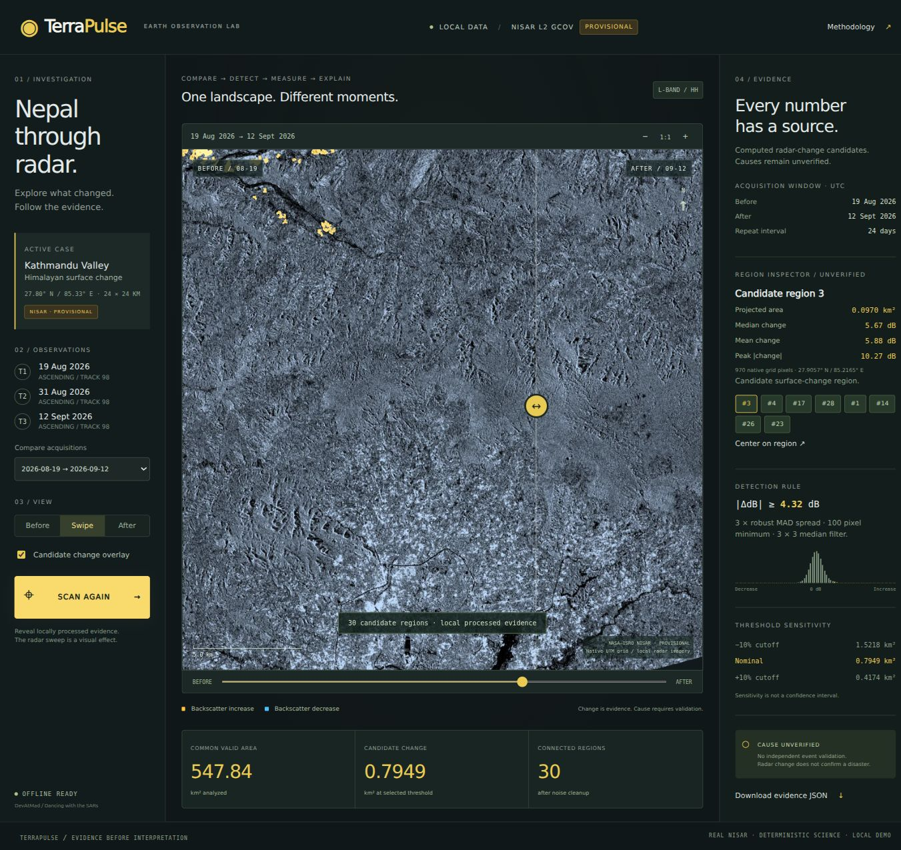
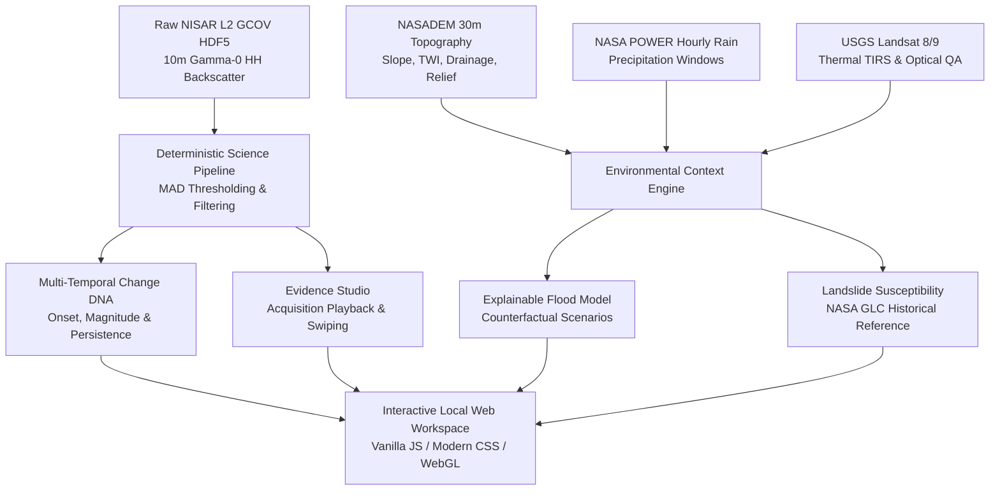
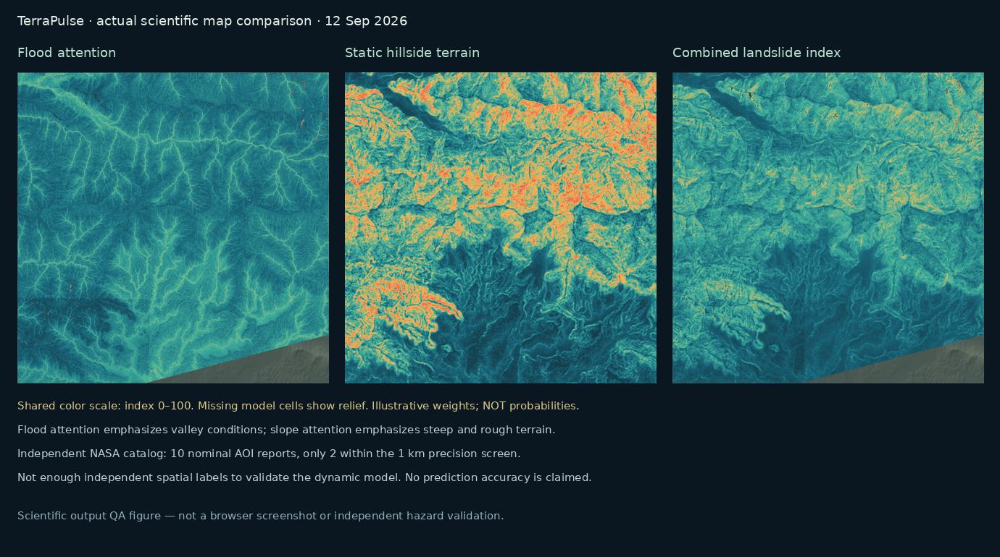

# 🛰️ TerraPulse

**Transparent Radar Surface-Change Investigation & Environmental Context**  
*NASA Space Apps Challenge 2026 · Challenge: Dancing with the SARs · Team: DevAtMad*

[](https://www.python.org/)
[](LICENSE)
[-success.svg)](#)
[](#verification-and-testing)
[-orange.svg)](docs/DATASETS.md)
[](#key-features--architecture)

---

## 🌍 Overview

**TerraPulse** transforms complex, cloud-penetrating synthetic aperture radar (SAR) measurements from the NASA–ISRO NISAR satellite into an interactive, mathematically rigorous, and fully transparent surface-change investigation platform.

Rather than presenting an ungrounded black-box classification or false disaster confidence, TerraPulse connects **radar backscatter physics**, **antecedent environmental context**, **temporal behavioral fingerprinting (Change DNA)**, and **explainable hazard models**—all operating 100% offline with full cryptographic data provenance.


*Figure 1: TerraPulse Evidence Studio displaying multi-temporal NISAR radar backscatter changes across the 24 km × 24 km Kathmandu study area.*

> [!IMPORTANT]
> **Scientific Integrity & Disclaimers:**
> - **NISAR Data Status:** Earth observation inputs are **PROVISIONAL** (collection `NISAR_L2_GCOV_PROVISIONAL_V1`).
> - **Physical Causation:** All identified backscatter change causes remain **UNVERIFIED** (radar changes can indicate soil moisture shifts, vegetation disturbance, or true ground deformation).
> - **Model Calibration:** Susceptibility and counterfactual scenario indices remain **UNCALIBRATED** demonstration models. Local completeness does not constitute an operational early-warning forecast or emergency response system.

---

## ⚡ Quick Start

### 🚀 1. Run with Existing Environment

The local workspace already includes pre-built analytical assets and the verified Python virtual environment:

```bash
# Launch the application (binds to http://127.0.0.1:8000/)
make run
```

Or run directly via the startup script:

```bash
./run.sh --port 8000
```

Open **[http://127.0.0.1:8000/](http://127.0.0.1:8000/)** in any modern web browser. Use `Ctrl+C` in your terminal to shut down the server.

### 💻 2. Setup on a Fresh Machine

```bash
# Clone the repository
git clone https://github.com/mahdimahmud2006-coder/nasa_space-apps_challenge.git
cd nasa_space-apps_challenge

# Create and activate virtual environment (Python 3.12+; 3.14 tested)
python3 -m venv .venv
source .venv/bin/activate

# Install verified dependencies
pip install -r requirements.txt

# Verify preflight and start server
make check-ready
./run.sh
```

> [!TIP]
> **Zero Network Dependency at Runtime:**  
> Once dependencies are installed, TerraPulse requires **no internet access**, no API keys, no Earthdata credentials, and no external CDNs or map-tile servers. All scripts, fonts, WebGL shaders, raster layers, and GeoJSON boundaries load directly from localhost.

---

## 🔬 Key Features & Architecture



### 🎛️ 1. Interactive Application Interfaces

| View | Route | Description & Key Capabilities |
|---|---|---|
| **Evidence Studio** | [`/`](web/index.html) | Radar-led primary workspace. Features discrete acquisition playback, interactive Before/After swipe slider, dynamic scan reveal, real-time candidate region ranking, and live histogram inspection. |
| **Change Lab** | [`/change-lab.html`](web/change-lab.html) | Deep-dive forensic analytics. Features Change DNA behavioral profiles, onset brackets, displacement magnitude, contraction vs. persistence analysis, and censored recovery tracking. |
| **Timeline View** | [`/timeseries.html`](web/timeseries.html) | Longitudinal time-series playback of radar observations without artificial date interpolation. Compares transition intervals against baseline references. |
| **Radar Comparison** | [`/comparison.html`](web/comparison.html) | Side-by-side analytical raster comparison, custom threshold sensitivity adjustment (±10%), and raw vs. robust mask overlays. |

### 🧬 2. Change DNA: Temporal Behavioral Profiling
In real-world SAR investigations, an anomaly mask may shrink even while the underlying baseline disturbance remains. TerraPulse distinguishes between:
- **Baseline Disturbance Persistence:** Retained displacement from pre-event radar levels.
- **Transition Mask Contraction:** Immediate temporal delta between consecutive revisit passes.
- **Onset & Recovery Bracketing:** Explicit right-censoring rather than interpolated daily recovery curves.

### 🏔️ 3. Environmental & Topographic Context
- **NASADEM Topographic Derivatives:** 30 m native elevation, slope, aspect, curvature, roughness, relative elevation, D8 flow accumulation, Topographic Wetness Index (TWI), and modeled Euclidean drainage proximity.
- **3D Terrain Canvas with 2D Fallback:** GPU-accelerated WebGL terrain rendering with keyboard navigation (`Arrow keys` to pan, `+`/`-` to zoom, `Enter` to probe coordinate, `Esc` to reset) and standard 2D canvas fallback.
- **NASA POWER Precipitation:** Hourly liquid-equivalent rainfall integrated across 24 h, 72 h, and 168 h windows preceding each radar pass.
- **USGS Landsat 8/9 Context:** Independent Tier-1 thermal surface temperature (TIRS Band 10) and optical RGB reflectance screened for cloud obscuration.

### 🌊 4. Transparent Hazard & Scenario Engines
- **Explainable Flood Escalation:** Additive component weighting combining terrain wetness, drainage proximity, low slope, antecedent precipitation, and NISAR backscatter decrease.
- **Counterfactual Scenario Studio:** Fast offline simulation engine exploring alternative rainfall multipliers (0.5×–3.0×) and soil saturation states using a compact 17 MB component cube.
- **Landslide Susceptibility Index:** Coupled static topography, dynamic rainfall triggers, and radar modifiers evaluated against the NASA/GSFC Global Landslide Catalog.


*Figure 2: Scientific validation maps comparing static topography, dynamic rainfall triggers, and radar-modulated susceptibility layers.*

---

## 📊 Study Case Specifications

The demonstration case investigates the 2026 monsoon event in the Kathmandu Valley and adjacent northern mountain fronts:

| Dimension | Specification | Source Provenance |
|---|---|---|
| **Geographic AOI** | 24 km × 24 km (2,400 × 2,400 pixels at 10 m native resolution) | Centered at 85.33° E, 27.80° N; UTM Zone 45N (EPSG:32645) |
| **Radar Acquisitions** | 2026-08-19, 2026-08-31, 2026-09-12 (12-day & 24-day intervals) | NASA–ISRO NISAR L2 GCOV (Track 98, Frame 16, 40 MHz, HH) |
| **Terrain Elevation** | 30 m grid; 1,173 m to 2,732 m elevation range | NASADEM HGT tiles (`n27e085`, `n28e085`) via Microsoft Planetary Computer |
| **Precipitation** | Hourly liquid-equivalent rates across regional cells | NASA POWER API (CERES/MERRA-2 assimilation) |
| **Thermal / Optical** | 30 m delivery grid; 4 cloud-screened scenes | USGS Landsat 8/9 Collection 2 Level-2 Surface Temperature/Reflectance |
| **Validation Reference** | 10 nominal study-AOI reports; 2 meet ≤1 km precision screen | NASA/GSFC Global Landslide Catalog (GLC) subset |

---

## 🛠️ Verification and Testing

TerraPulse enforces rigorous scientific validation, automated testing, and export consistency checks.

```bash
# 1. Run fast local runtime preflight (verifies dependencies and assets)
make check-ready

# 2. Run Python automated unit and numerical test suite (169 tests)
make test

# 3. Run JavaScript interaction, math, and UI controller test suite (25 tests)
make test-ui

# 4. Run static HTML/CSS/DOM asset integrity verification
make check-web

# 5. Run full verification suite (all tests + 5 analytical validators)
make verify
```

### Test Coverage Highlights

- **169 Python Tests:** Verifies pixel area determinants, signed delta dB math, median filter speckle reduction, MAD threshold calculations, geometry alignment, Parquet schema, and API route responses.
- **25 JavaScript Tests:** Verifies swipe slider math, 3D/2D coordinate transformations, timeline state transitions, keyboard controls, and DOM event listeners.
- **5 Analytical Validators:**
  - `validate` (Primary NISAR radar delta and vector geometry)
  - `validate-timeseries` (Cloud-Optimized GeoTIFFs, transition frequencies, and Parquet continuity)
  - `validate-context` (Terrain derivatives, drainage routing, and rainfall consistency)
  - `validate-flood` (Monotonicity under rainfall scaling, scenario cache integrity)
  - `validate-change-lab` (508 byte-for-byte prior historical artifacts preserved)

---

## 📦 Portable Release Packaging

TerraPulse can be compiled into a standalone, reproducible zip package containing all application code, public COG rasters, and runtime scenario cubes (excluding multi-gigabyte raw HDF5 files):

```bash
# Build standalone release package
make release
```

This generates:
- `dist/terrapulse-1.0.0.zip` (self-contained offline distribution)
- `dist/terrapulse-1.0.0.zip.sha256` (cryptographic verification hash)

To verify and run an extracted release bundle:
```bash
python3 scripts/verify_release.py
bash run.sh
```

---

## 📂 Project Structure

```text
NEPALv1/
├── Makefile                          # Build, verification, and execution targets
├── run.sh                            # Preflight check and local server launcher
├── config.*.json                     # Modular configurations (project, flood, context, etc.)
├── requirements.txt                  # Pinned Python dependencies
├── pyproject.toml                    # Package metadata & build definition
│
├── src/                              # Core Python Science & API Modules
│   ├── api/                          # Local standard-library HTTP server & preflight
│   ├── compute/                      # Deterministic radar math, terrain, flood & landslide pipelines
│   ├── ingest/                       # HDF5 inspection, STAC metadata, and reference readers
│   └── export/                       # GeoTIFF COGs, GeoJSON, and evidence JSON serializers
│
├── web/                              # Offline User Interface
│   ├── index.html                    # Evidence Studio interface
│   ├── change-lab.html               # Change Lab (DNA & Landslide forensic view)
│   ├── timeseries.html               # Multi-temporal playback timeline
│   ├── comparison.html               # Direct swipe comparison view
│   ├── studio.mjs / studio.css       # Studio modular components and design tokens
│   ├── change-lab.mjs / change-lab.css
│   ├── terrain-view.mjs              # WebGL 3D terrain & 2D fallback renderer
│   └── public/cases/nepal_case_01/   # Public Cloud-Optimized GeoTIFFs, WebP, & GeoJSON
│
├── tests/                            # Automated Testing Suites
│   ├── test_science.py               # Radar and analytical tests
│   ├── test_flood_model.py           # Flood escalation and monotonicity tests
│   ├── test_landslide.py             # Terrain and susceptibility tests
│   ├── test_timeseries.py            # Time-series persistence tests
│   └── *.test.mjs                    # Node.js UI logic and controller tests
│
├── scripts/                          # Packaging & Verification Utilities
│   ├── check_web.py                  # Static HTML/CSS validator
│   ├── package_release.py            # Release bundler with SHA-256 manifests
│   └── verify_release.py             # Zero-dependency release integrity verifier
│
└── docs/                             # Comprehensive Documentation & Reports
    ├── DATASETS.md                   # Complete data provenance and access rules
    ├── METHODOLOGY.md                # Scientific formulations and processing steps
    ├── VALIDATION.md                 # Verification protocols and criteria
    ├── LIMITATIONS.md                # Scientific constraints and edge cases
    ├── FINAL_PROJECT_READINESS.md    # Readiness diagnosis and audit matrix
    ├── SUBMISSION_BRIEF.md           # 3-minute presentation script and challenge brief
    └── reports/                      # QA test logs, prior artifact hashes, and figures
```

---

## 📚 Documentation Directory

For in-depth architectural, scientific, and challenge details, explore the complete documentation suite:

- 📖 [**Submission Brief & Narrative**](docs/SUBMISSION_BRIEF.md): Executive summary, 3-minute presentation script, and challenge alignment.
- 📋 [**Final Project Readiness Diagnosis**](docs/FINAL_PROJECT_READINESS.md): Audit table of identified gaps, solutions, and verification results.
- 🛰️ [**Dataset Provenance & Ingestion**](docs/DATASETS.md): Exact granule IDs, bounding coordinates, and download procedures.
- 📐 [**Methodology & Algorithms**](docs/METHODOLOGY.md): Mathematical formulations for dB conversion, robust MAD cutoffs, and terrain metrics.
- ⚠️ [**Scientific Limitations**](docs/LIMITATIONS.md): Transparent disclosure of radar ambiguity, spatial resolution, and validation constraints.
- 🤖 [**AI Assistance Record**](docs/AI_USE.md): Disclosure of code-generation assistance and deterministic runtime separation.
- 📈 [**Progress & Milestones**](PROJECT_PROGRESS.md): Full chronicle from raw HDF5 discovery to implementation 07.

---

## ⚖️ License & Attribution

- **Code License:** [Apache 2.0](LICENSE) © 2026 DevAtMad.
- **NASA Data:** Distributed under NASA Earth Science Open Data Policy.
- **USGS Landsat:** USGS/NASA Landsat data distributed via USGS Public Domain.
- **DEM Data:** NASADEM courtesy of NASA JPL.
- **Landslide Catalog:** NASA/GSFC Global Landslide Catalog courtesy of Kirschbaum et al. (2010, 2015).
